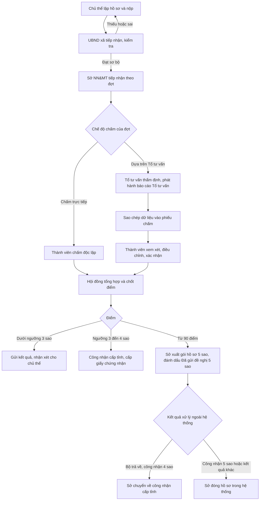
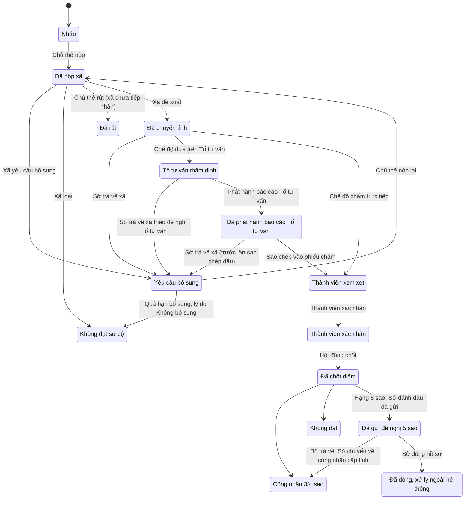
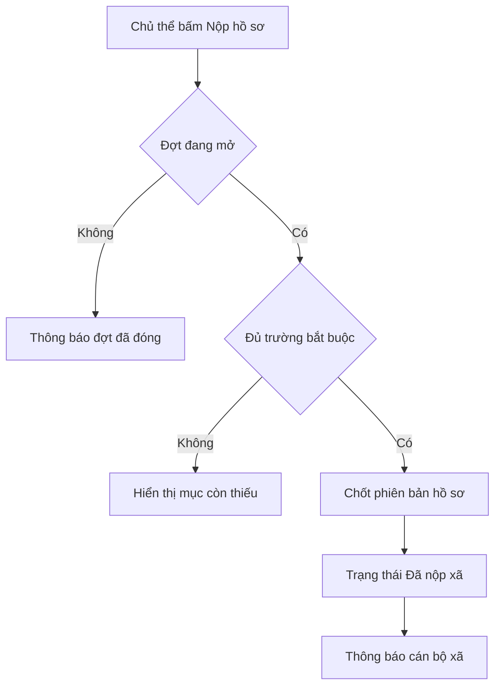
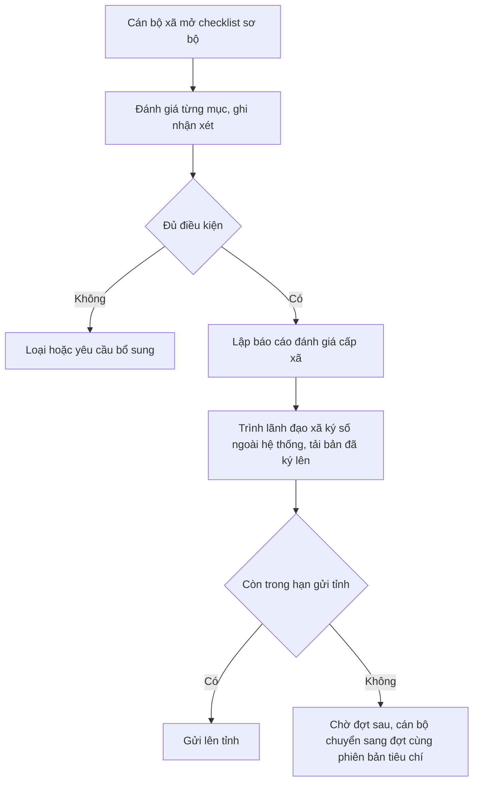
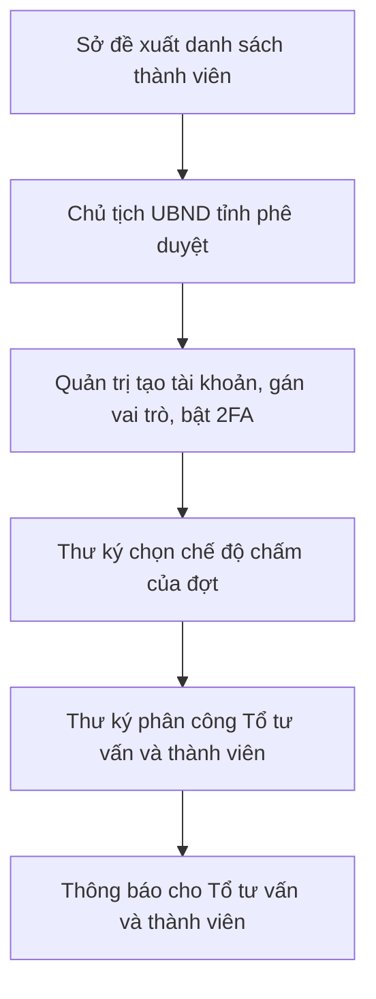
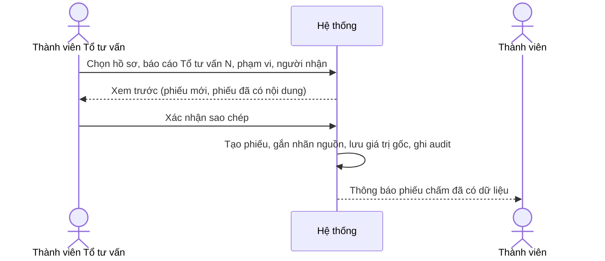
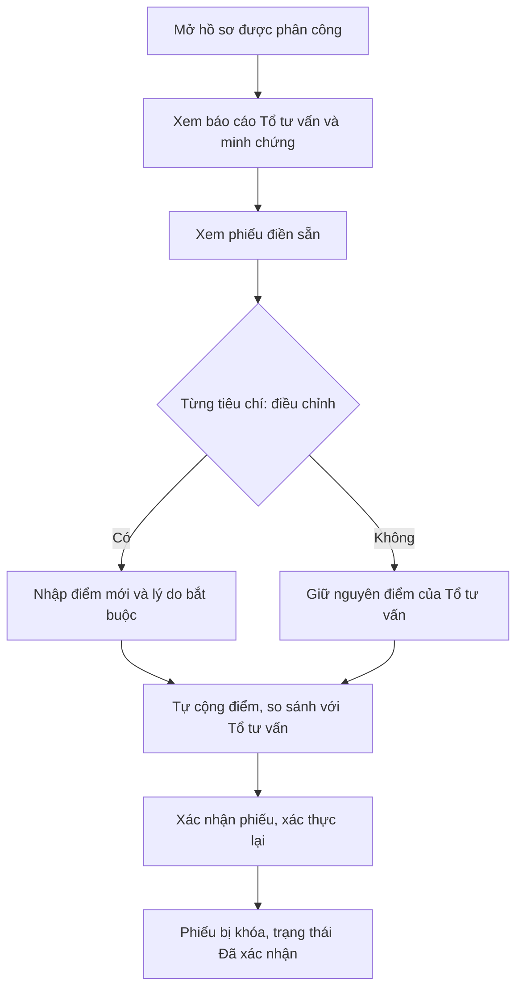
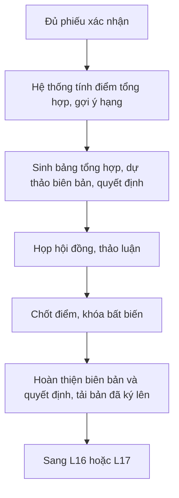
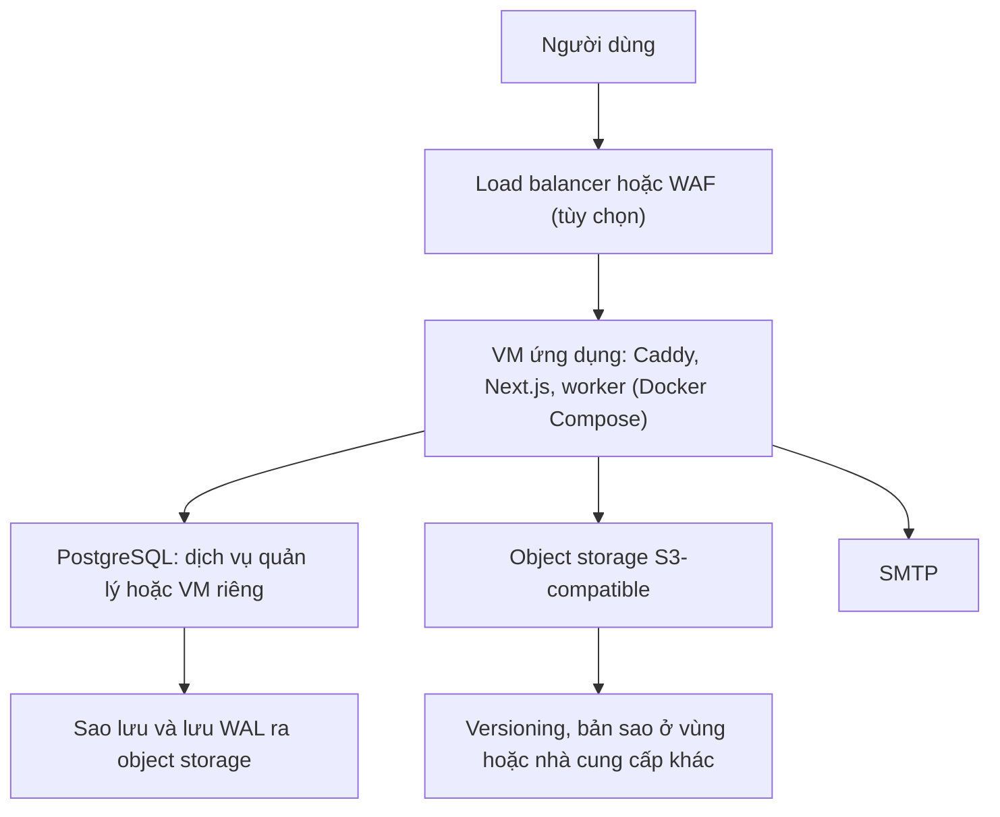

# Luồng xử lý chi tiết: bản rút gọn cho một tỉnh

Tài liệu mô tả luồng xử lý cho 64 mã chức năng gốc được giữ lại, cộng phần xác thực hai lớp của DC-09 (xem `OCOP_tinh_nang_rut_gon.xlsx`). Các chức năng bị hoãn hoặc làm ngoài hệ thống nằm ở sheet "Hoãn hoặc cắt". Hệ thống triển khai trên cloud trong nước (VNG/GreenNode, FPT, Viettel), xem phụ lục A.

## 0. Quy ước

- **Mã chức năng:** CT (Chủ thể), XA (UBND xã), SO (Sở NN&MT), HD (Hội đồng tỉnh), TM (Tổ tư vấn), TV (Thành viên hội đồng), AD (Quản trị), CK (Cổng công khai), DC (Dùng chung).
- **Đợt triển khai:** Đợt 1 là luồng lõi; Đợt 2 gồm CT-15, SO-06, HD-12, CK-02 (QR và thống kê). Có thể điều chỉnh.
- **Giá trị cấu hình:** ngưỡng điểm, mốc thời gian, số thành viên chấm, mẫu văn bản, thời hạn nhắc nằm trong cấu hình đợt hoặc phiên bản tiêu chí, không viết cứng. Các giá trị này cần đối chiếu văn bản gốc (QĐ 26/2026/QĐ-TTg và quy chế hội đồng).
- **Bộ NN&MT không phải người dùng hệ thống.** Hệ thống chỉ có công cụ xuất gói hồ sơ 5 sao; việc gửi đánh giá và nhận kết quả thực hiện bằng văn bản ngoài hệ thống (luồng L17).
- **Quy tắc chung cho mọi luồng:**
  1. Mỗi lần chuyển trạng thái ghi một sự kiện: ai, khi nào, từ trạng thái nào sang trạng thái nào, lý do.
  2. Thông báo đi qua dịch vụ thông báo chung (L23); tệp đi qua dịch vụ tệp chung (L24).
  3. Thao tác nhạy cảm (xác nhận phiếu, chốt điểm, sao chép dữ liệu của Tổ tư vấn) có audit riêng (L21).
  4. Ký số làm ngoài hệ thống: xuất PDF hoặc Word, ký bằng công cụ sẵn có, tải bản đã ký lên như tệp đính kèm.

## 1. Luồng tổng thể và vòng đời hồ sơ

### 1.1 Luồng tổng thể

### 1.2 Vòng đời trạng thái

Vòng đời có 15 trạng thái: 14 trạng thái gốc và **Đã rút** (ADR 0007). Tiếp nhận, đổi cán bộ phụ trách, chuyển xã và chuyển đợt không phải trạng thái; chúng là sự kiện trên hồ sơ ở "Đã nộp xã".

## 2. Nhóm Chủ thể OCOP

### L01. Đăng ký, đăng nhập và hồ sơ pháp lý
**Chức năng:** CT-01, CT-02 · **Tác nhân:** Chủ thể · **Đợt 1**

**Tiền điều kiện:** có email hợp lệ.

**Luồng chính**
1. Chủ thể chọn loại tổ chức (doanh nghiệp, HTX, hộ sản xuất), nhập thông tin và chọn xã/phường.
2. Hệ thống gửi email xác thực; chủ thể xác nhận và đặt mật khẩu.
3. Chủ thể tải lên giấy tờ pháp lý (GPKD, VSATTP, công bố chất lượng) kèm ngày hiệu lực.
4. Tài khoản chuyển sang "Đã xác thực" và dùng được để lập hồ sơ sản phẩm.

**Ngoại lệ**
- Tài khoản trùng (cùng mã số thuế hoặc số định danh): cảnh báo và hướng dẫn khôi phục.
- Tệp sai định dạng hoặc quá dung lượng: báo lỗi.
- Hộ sản xuất không rành công nghệ: cán bộ xã hỗ trợ tạo tài khoản và nhập hộ (thao tác quản trị, có ghi audit).

**Dữ liệu ghi nhận:** hồ sơ tổ chức, giấy tờ kèm ngày hiệu lực, lịch sử cập nhật.

---

### L02. Hồ sơ sản phẩm, minh chứng và tự chấm điểm thử
**Chức năng:** CT-03, CT-05, CT-06 · **Tác nhân:** Chủ thể · **Đợt 1**

**Luồng chính**
1. Chủ thể tạo hồ sơ sản phẩm, chọn một Bộ tiêu chí theo cây Nhóm sản phẩm → Phân nhóm → Bộ tiêu chí của Phiên bản tiêu chí áp dụng: phiên bản của đợt đang nhận nộp, nếu không có đợt mở thì phiên bản phát hành mới nhất. Hệ thống báo rõ Bộ tiêu chí và văn bản căn cứ không đổi được sau khi tạo.
2. Hệ thống tải Bộ tiêu chí đã chọn; hồ sơ gắn cố định với bộ này.
3. Chủ thể nhập thông tin sản phẩm: tên, mô tả, nguyên liệu, quy trình, bao bì, công bố chất lượng.
4. Với mỗi tiêu chí, chủ thể tải lên minh chứng và ghi giải trình. Một tệp có thể gắn với nhiều tiêu chí.
5. Chủ thể bấm "Tự chấm điểm thử": chọn một Mức điểm cho từng tiêu chí; hệ thống cộng điểm Phần A, B, C, tổng và ước lượng Hạng sao theo Ngưỡng hạng và Sao tối thiểu (xem L19).
6. Hệ thống tự lưu nháp; hồ sơ giữ trạng thái "Nháp" đến khi nộp.

**Ngoại lệ**
- Muốn đổi Bộ tiêu chí, hoặc đợt đang mở áp dụng phiên bản khác: tạo hồ sơ mới. Thao tác "Sao chép sang hồ sơ mới" chép thông tin sản phẩm và tệp minh chứng (vào kho minh chứng chưa gắn tiêu chí, chủ thể gắn lại); không chép điểm tự chấm và giải trình theo tiêu chí. Hồ sơ mới chỉ ghi "sao chép từ hồ sơ X" để tra cứu.
- Tiêu chí chưa có minh chứng: vẫn chấm thử được nhưng đánh dấu "chưa có minh chứng".

**Quy tắc:** điểm tự chấm chỉ mang tính tham khảo, giao diện ghi rõ; không dùng làm điểm chính thức.

---

### L03. Nộp hồ sơ, theo dõi trạng thái và nhắc hạn
**Chức năng:** CT-09, CT-10, CT-12 · **Tác nhân:** Chủ thể, hệ thống · **Đợt 1**

**Tiền điều kiện:** có đợt Đang nhận nộp (L07) áp dụng đúng Phiên bản tiêu chí của hồ sơ; hồ sơ đủ trường bắt buộc.

**Luồng chính**
1. Chủ thể bấm "Nộp hồ sơ"; hệ thống kiểm tra trường bắt buộc và minh chứng tối thiểu.
2. Hệ thống chốt phiên bản hồ sơ đã nộp (không sửa trực tiếp) và chuyển "Đã nộp xã".
3. Hệ thống thông báo cán bộ xã phụ trách.
4. Chủ thể xem trạng thái và lịch sử xử lý theo dòng thời gian.
5. Hệ thống nhắc hạn nộp qua email và trong ứng dụng theo các mốc cấu hình (ví dụ 30, 14, 7, 1 ngày trước hạn).

**Ngoại lệ**
- Hết hạn nộp: hồ sơ giữ ở "Nháp", nộp được vào đợt kế tiếp nếu đợt đó áp dụng cùng Phiên bản tiêu chí; nếu khác, hồ sơ hiển thị "Không nộp được vào đợt hiện tại: khác phiên bản tiêu chí" kèm nút tạo hồ sơ mới (L02).
- Rút hồ sơ khi xã chưa tiếp nhận: trạng thái "Đã rút", ghi lý do.

**Dữ liệu ghi nhận:** phiên bản hồ sơ, thời điểm nộp, lịch sử trạng thái, lịch nhắc.

---

### L04. Yêu cầu bổ sung và nộp lại
**Chức năng:** CT-11, XA-05 · **Tác nhân:** Cán bộ xã hoặc Sở, Chủ thể · **Đợt 1**

**Luồng chính**
1. Cán bộ xã (hoặc Sở, khi trả hồ sơ về xã theo đề nghị của Tổ tư vấn) chọn "Yêu cầu bổ sung": ghi từng nội dung cần bổ sung, gắn với tiêu chí hoặc giấy tờ, đặt hạn.
2. Hệ thống chuyển hồ sơ sang "Yêu cầu bổ sung" và thông báo chủ thể.
3. Chủ thể xem yêu cầu, chỉnh sửa hoặc tải thêm minh chứng, trả lời từng mục.
4. Chủ thể bấm "Nộp lại"; hệ thống tạo phiên bản mới, giữ phiên bản cũ.
5. Hồ sơ quay về "Đã nộp xã"; người yêu cầu nhận thông báo.

**Ngoại lệ**
- Quá hạn bổ sung: hệ thống nhắc, sau đó cho phép cán bộ đóng hồ sơ về "Không đạt sơ bộ" với lý do "Không bổ sung".
- Hồ sơ đã ở tỉnh: chỉ Sở trả về xã, tránh nhiều đầu mối yêu cầu cùng lúc. Sở trả về được cho đến trước lần sao chép đầu sang phiếu thành viên (kể cả khi báo cáo Tổ tư vấn đã phát hành; các phiên bản đã phát hành được giữ); từ "Thành viên xem xét" trở đi không trả về được.

**Dữ liệu ghi nhận:** danh sách yêu cầu, phản hồi từng mục, các phiên bản hồ sơ.

## 3. Nhóm UBND xã/phường

### L05. Tiếp nhận, kiểm tra và chỉ định cán bộ phụ trách
**Chức năng:** XA-01, XA-02, XA-03 · **Tác nhân:** Cán bộ xã · **Đợt 1**

**Luồng chính**
1. Hồ sơ mới nộp hiện trong danh sách "Chờ tiếp nhận" của xã, ghi ngày nhận.
2. Cán bộ xã tiếp nhận hồ sơ và chỉ định cán bộ phụ trách (mặc định là chính mình). Mọi cán bộ xã của xã đều xem và xử lý được hồ sơ; cán bộ phụ trách là người nhận việc và thông báo.
3. Cán bộ kiểm tra tính hợp lệ của chủ thể (đúng địa bàn, đúng đối tượng) và tính đầy đủ tài liệu theo danh mục.
4. Cán bộ chọn một trong ba kết quả: chuyển sang đánh giá sơ bộ, yêu cầu bổ sung (L04), hoặc loại kèm lý do.

**Ngoại lệ**
- Hồ sơ không thuộc địa bàn: chuyển sang xã đúng hoặc trả chủ thể, ghi lý do.
- Cán bộ nghỉ hoặc quá tải: cán bộ xã đổi cán bộ phụ trách, hệ thống ghi lịch sử.

**Dữ liệu ghi nhận:** ngày nhận, người phụ trách, kết quả kiểm tra, lý do loại.

---

### L06. Đánh giá sơ bộ, lập báo cáo đánh giá cấp xã và gửi lên tỉnh
**Chức năng:** XA-04, XA-07, XA-08 · **Tác nhân:** Cán bộ xã · **Đợt 1**

**Luồng chính**
1. Cán bộ mở checklist sơ bộ của đợt (mặc định: tính pháp lý; tính hợp lệ của phiếu đăng ký và báo cáo tự đánh giá; nguồn gốc nguyên liệu địa phương và quy mô sản xuất; lao động địa phương; bản sắc văn hóa và trí tuệ bản địa).
2. Với mỗi mục, chọn đạt, không đạt hoặc cần xác minh, kèm nhận xét.
3. Hệ thống tổng hợp và đề xuất "Đủ điều kiện chuyển tỉnh" hoặc "Chưa đủ".
4. Cán bộ lập báo cáo đánh giá cấp xã cho hồ sơ từ mẫu Word (mỗi hồ sơ một báo cáo); hệ thống điền sẵn thông tin chủ thể, sản phẩm và kết quả checklist.
5. Cán bộ trình lãnh đạo UBND xã ký số ngoài hệ thống rồi tải bản đã ký lên; chưa có bản đã ký thì không gửi tỉnh được. Lãnh đạo xã không phải người dùng của hệ thống.
6. Cán bộ gửi hồ sơ lên tỉnh trong hạn gửi tỉnh của đợt; hệ thống chuyển "Đã chuyển tỉnh", đính kèm toàn bộ tài liệu, thông báo Sở và chủ thể.

**Ngoại lệ**
- Quá hạn gửi của đợt: hồ sơ ở lại "Đã nộp xã" với nhãn "Chờ đợt sau"; khi có đợt cùng phiên bản tiêu chí, cán bộ chuyển hồ sơ sang đợt đó kèm lý do, thông báo chủ thể.
- Phát hiện sai sót sau khi gửi: xã đề nghị Sở trả về (ghi lý do) trước khi thẩm định bắt đầu.

**Dữ liệu ghi nhận:** kết quả checklist, báo cáo đánh giá cấp xã (bản Word sinh ra và bản PDF đã ký), đợt gửi, thời điểm gửi.

## 4. Nhóm cấp tỉnh

### L07. Quản lý đợt đánh giá và danh mục
**Chức năng:** SO-01, AD-06 · **Tác nhân:** Sở NN&MT, quản trị · **Đợt 1**

**Luồng chính**
1. Sở NN&MT tạo đợt (trạng thái Nháp): tên, năm, ba mốc hạn (Hạn nộp xã: chủ thể nộp về xã; Hạn gửi tỉnh: xã đề xuất lên tỉnh; Hạn đánh giá tỉnh: chỉ để nhắc việc), chế độ chấm ban đầu (trực tiếp hoặc dựa trên Tổ tư vấn), Phiên bản tiêu chí đã phát hành, Quy tắc tổng hợp.
2. Hệ thống kiểm tra thứ tự các mốc hạn và tại mỗi thời điểm có tối đa một đợt Đang nhận nộp (nhiều đợt có thể cùng ở Đã đóng nộp).
3. Sở bấm "Mở đợt" (Đang nhận nộp); hệ thống thông báo các xã và chủ thể.
4. Qua Hạn nộp xã, hệ thống tự chuyển đợt sang Đã đóng nộp; chỉ còn xử lý hồ sơ đã nộp. Qua Hạn gửi tỉnh, xã không đề xuất thêm hồ sơ của đợt.
5. Khi mọi hồ sơ của đợt ở trạng thái cuối hoặc đã chốt, Sở "Kết thúc đợt" (Đã kết thúc).

**Ngoại lệ**
- Gia hạn đợt: Sở lùi Hạn nộp xã, Hạn gửi tỉnh hoặc Hạn đánh giá tỉnh, ghi lý do, thông báo đối tượng liên quan; không rút ngắn hạn khi đợt đã mở. Hạn nộp xã chỉ gia hạn được khi đợt còn Đang nhận nộp, sang một ngày trong tương lai; Hạn gửi tỉnh và Hạn đánh giá tỉnh gia hạn được khi đợt Đang nhận nộp hoặc Đã đóng nộp. Đợt ở trạng thái Đã đóng nộp không mở lại.
- Đợt đã mở không đổi được Phiên bản tiêu chí (tránh lệch giữa các hồ sơ). Quy tắc tổng hợp khóa khi đợt có phiếu chấm đầu tiên.
- Xã chuyển hồ sơ sang đợt sau (XA-08) chỉ khi đợt sau áp dụng cùng Phiên bản tiêu chí, ghi lý do; nếu khác phiên bản, xã kết luận không đạt sơ bộ hoặc trả về chủ thể.

**Danh mục (quản trị):** danh sách xã/phường của tỉnh, có lịch sử sáp nhập để hồ sơ cũ vẫn truy được tên đơn vị cũ. Nhóm sản phẩm không phải danh mục quản trị: cây phân loại nằm trong Phiên bản tiêu chí (L19, ADR 0006).

---

### L08. Tiếp nhận hồ sơ tại tỉnh
**Chức năng:** SO-02 · **Tác nhân:** Cán bộ Sở NN&MT · **Đợt 1**

**Luồng chính**
1. Hồ sơ từ xã hiện trong danh sách "Chờ tiếp nhận" của tỉnh theo đợt.
2. Cán bộ lọc theo đợt, xã, nhóm sản phẩm, trạng thái và kiểm tra nhanh tính đủ điều kiện.
3. Cán bộ xác nhận tiếp nhận; hồ sơ sang bước phân công (L09).
4. Hồ sơ thiếu hoặc sai: Sở trả về xã kèm lý do, đi qua L04.

**Ghi chú:** mã hiển thị của hồ sơ (do hệ thống sinh sẵn) dùng làm mã theo dõi.

---

### L09. Thành lập hội đồng, phân công và chọn chế độ chấm
**Chức năng:** HD-01, HD-02, HD-03, HD-06 · **Tác nhân:** Chủ tịch UBND tỉnh hoặc người được ủy quyền, thư ký hội đồng, Sở NN&MT · **Đợt 1**

**Luồng chính**
1. Sở lập danh sách đề xuất thành viên Hội đồng và thành viên Tổ tư vấn (chuyên môn, đơn vị).
2. Chủ tịch UBND tỉnh quyết định thành lập Hội đồng và Tổ tư vấn (theo QĐ 26/2026/QĐ-TTg, thay thế QĐ 1489/QĐ-TTg); hệ thống lưu quyết định, chủ tịch và thư ký hội đồng, thành viên Tổ tư vấn (tải quyết định lên như tệp).
3. Quản trị tạo tài khoản, gán vai trò thành viên và bật 2FA (L20).
4. Thư ký xác nhận hoặc đổi chế độ chấm của đợt do Sở đặt ban đầu: trực tiếp hoặc dựa trên Tổ tư vấn (HD-06).
5. Thư ký phân công Tổ tư vấn phụ trách hồ sơ (HD-03) và thành viên cho từng hồ sơ (HD-02); hệ thống kiểm tra số thành viên tối thiểu theo cấu hình.
6. Thành viên và Tổ tư vấn nhận thông báo.

**Ngoại lệ**
- Thành viên có xung đột lợi ích: khai báo bằng văn bản; thư ký thay người phân công và ghi lý do vào hồ sơ.
- Đổi chế độ chấm khi đợt đã có phiếu chấm: không cho phép; chỉ đổi được trước phiếu đầu tiên của đợt, có audit.

**Quy tắc:** số thành viên chấm mỗi hồ sơ và điều kiện hợp lệ của hội đồng lấy từ cấu hình, cần đối chiếu quy chế.

## 5. Tổ tư vấn và thành viên hội đồng

### L10. Thẩm định hồ sơ và chấm điểm đề xuất
**Chức năng:** TM-01, TM-02, TM-05, TM-06 · **Tác nhân:** Thành viên Tổ tư vấn · **Đợt 1**

**Tiền điều kiện:** hồ sơ đã được phân công cho Tổ tư vấn (L09), chế độ chấm của đợt là "dựa trên Tổ tư vấn".

**Luồng chính**
1. Cán bộ mở danh sách hồ sơ được giao, sắp theo hạn xử lý.
2. Rà soát minh chứng theo từng tiêu chí; đánh dấu thiếu, không hợp lệ hoặc cần xác minh.
3. Nhập **điểm đề xuất** từng tiêu chí kèm căn cứ và viện dẫn minh chứng.
4. Hệ thống tự cộng điểm nhóm A, B, C và tổng, kiểm tra giá trị nằm trong khung điểm.
5. Soạn nhận xét tổng hợp và các điểm cần hội đồng lưu ý.
6. Lưu nháp; hồ sơ ở "Tổ tư vấn thẩm định".

**Ngoại lệ**
- Thiếu hồ sơ nghiêm trọng: Tổ tư vấn đề nghị Sở trả hồ sơ về xã (L04).
- Cần xác minh thực địa: thực hiện ngoài hệ thống, đính kèm biên bản và ảnh vào báo cáo Tổ tư vấn như tệp thường.

**Dữ liệu ghi nhận:** điểm đề xuất theo tiêu chí, căn cứ, nhận xét, người nhập, thời gian.

**Quy tắc:** điểm của Tổ tư vấn chỉ là đề xuất, không phải điểm chính thức.

---

### L11. Phát hành báo cáo Tổ tư vấn và giới hạn quyền
**Chức năng:** TM-07, TM-12 · **Tác nhân:** Tổ trưởng Tổ tư vấn · **Đợt 1**

**Luồng chính**
1. Tổ trưởng rà soát báo cáo Tổ tư vấn nháp.
2. Bấm "Phát hành"; hệ thống kiểm tra đủ điểm và căn cứ cho mọi tiêu chí.
3. Hệ thống khóa nội dung thành **phiên bản N** (bất biến), ghi người phát hành và thời điểm.
4. Thành viên được phân công nhận thông báo "Có báo cáo Tổ tư vấn mới".

**Sửa sau khi phát hành:** Tổ tư vấn tạo phiên bản N+1 từ phiên bản N, ghi lý do. Việc sao chép lại tuân theo quy tắc ở L12. Hồ sơ bị Sở trả về xã ở trạng thái này rồi lên tỉnh lại thì giữ các phiên bản đã phát hành; lần phát hành tiếp theo cũng là phiên bản N+1 có lý do.

**Phân quyền (TM-12):** vai trò Tổ tư vấn không có quyền chốt điểm chính thức, không có quyền quyết định công nhận, không sửa phiếu chấm đã được thành viên chỉnh hoặc xác nhận.

---

### L12. Sao chép dữ liệu của Tổ tư vấn cho thành viên
**Chức năng:** TM-08, TM-09 · **Tác nhân:** Thành viên Tổ tư vấn, hệ thống · **Đợt 1**

**Tiền điều kiện:** có báo cáo Tổ tư vấn đã phát hành; chế độ chấm của đợt là "dựa trên Tổ tư vấn"; thành viên đã được phân công hồ sơ.

**Luồng chính**
1. Thành viên Tổ tư vấn chọn hồ sơ (một hoặc nhiều) và báo cáo Tổ tư vấn phiên bản N.
2. Chọn phạm vi: toàn bộ hoặc từng tiêu chí; chọn người nhận (một, nhiều hoặc tất cả thành viên được phân công).
3. Hệ thống xem trước: phiếu nào sẽ được điền sẵn, phiếu nào đã có nội dung.
4. Cán bộ xác nhận; hệ thống tạo hoặc cập nhật phiếu chấm của từng thành viên với các trường điểm, nhận xét, căn cứ.
5. Mỗi giá trị sao chép gắn nhãn "từ Tổ tư vấn, phiên bản N" và lưu giá trị gốc (`advisory_snapshot`).
6. Hệ thống ghi audit (ai sao chép, từ phiên bản nào, cho ai, lúc nào) và thông báo thành viên.

**Sao chép lại từ phiên bản mới**
- Xét theo từng tiêu chí: tiêu chí thành viên chưa chỉnh được cập nhật theo phiên bản mới; tiêu chí đã chỉnh được giữ nguyên và báo lại.
- Phiếu đã xác nhận: bỏ qua toàn bộ, không ghi đè. Thành viên Tổ tư vấn nhận danh sách tiêu chí và phiếu bị bỏ qua. (Bản rút gọn không có màn hình so sánh chênh lệch.)

**Ngoại lệ**
- Chế độ chấm trực tiếp: nút sao chép bị ẩn.
- Phiếu đã xác nhận: không thể sao chép đè; chỉ mở khóa được bằng thao tác quản trị kỹ thuật (L15).

**Dữ liệu ghi nhận:** phiếu chấm, nhãn nguồn, giá trị gốc của Tổ tư vấn, log sao chép.

---

### L13. Thành viên xem xét, điều chỉnh và xác nhận
**Chức năng:** TV-01, TV-02, TV-03, TV-04, TV-05 · **Tác nhân:** Thành viên hội đồng · **Đợt 1**

**Luồng chính**
1. Thành viên chỉ thấy danh sách hồ sơ được phân công (TV-01).
2. Mở hồ sơ, xem báo cáo Tổ tư vấn và minh chứng gốc (TV-02).
3. Xem phiếu chấm đã điền sẵn từ Tổ tư vấn, mỗi trường có nhãn nguồn (TV-03).
4. Với từng tiêu chí, chọn giữ nguyên hoặc điều chỉnh. Điều chỉnh điểm thì bắt buộc nhập lý do (TV-04).
5. Hệ thống tự cộng điểm và hiển thị so sánh với điểm của Tổ tư vấn.
6. Thành viên bấm "Xác nhận phiếu" (TV-05); hệ thống yêu cầu xác thực lại (OTP) và khóa phiếu.

**Ngoại lệ**
- Điểm vượt khung hoặc thiếu lý do: không cho xác nhận.
- Muốn sửa sau khi xác nhận: chỉ qua mở khóa của quản trị kỹ thuật (L15).

**Quy tắc:** thành viên chịu trách nhiệm điểm cuối cùng; không thấy phiếu của thành viên khác cho đến khi chốt (cần xác nhận theo quy chế).

---

### L14. Chế độ chấm trực tiếp
**Chức năng:** TV-06, TV-07 · **Tác nhân:** Thành viên hội đồng · **Đợt 1**

**Tiền điều kiện:** chế độ chấm của đợt là "trực tiếp".

**Luồng chính**
1. Thành viên mở hồ sơ và phiếu chấm trống.
2. Chấm từng tiêu chí, ghi nhận xét, đính kèm bằng chứng kiểm tra (TV-07).
3. Hệ thống ẩn điểm của các thành viên khác (TV-06).
4. Hệ thống tự cộng điểm; thành viên xác nhận phiếu như ở L13 bước 6.

**Quy tắc:** điểm của người khác chỉ hiển thị sau khi hội đồng chốt (L15).

---

### L15. Tổng hợp, chốt điểm, họp và quyết định
**Chức năng:** HD-04, HD-05, HD-08, HD-09, TV-08 · **Tác nhân:** Thư ký, chủ tịch hội đồng, Tổ tư vấn · **Đợt 1**

**Luồng chính**
1. Hệ thống theo dõi tiến độ xác nhận phiếu; hồ sơ đủ phiếu chuyển "Sẵn sàng chốt".
2. Hệ thống tính điểm tổng hợp theo quy tắc cấu hình (trung bình, cách xử lý điểm lệch...) và gợi ý hạng theo ngưỡng (HD-04, HD-05).
3. Hệ thống sinh bảng tổng hợp điểm, dự thảo biên bản và dự thảo quyết định từ mẫu Word (HD-09, gộp tài liệu họp của Tổ tư vấn).
4. Họp hội đồng: thành viên xem điểm của nhau và điểm tổng hợp (TV-08), thảo luận các hồ sơ lệch điểm lớn.
5. Chủ tịch hoặc thư ký bấm "Chốt điểm"; hệ thống khóa bất biến phiếu và điểm tổng hợp (HD-08).
6. Thư ký hoàn thiện biên bản và quyết định, ký số ngoài hệ thống, tải bản đã ký lên.

**Mở khóa (xử lý sự cố):** nếu cần sửa điểm sau khi chốt, hội đồng có văn bản yêu cầu; quản trị kỹ thuật mở khóa bằng thao tác riêng có ghi audit (người yêu cầu, lý do, thời điểm). Sau khi sửa, chốt lại và tạo phiên bản mới của biên bản. Đây không phải màn hình thông thường trên giao diện.

**Quy tắc:** một số tỉnh quy định Hội đồng chỉ họp khi đủ số thành viên tối thiểu và đã có báo cáo thẩm tra của Tổ tư vấn (ví dụ quy chế của Ninh Bình). Nếu áp dụng, hệ thống chặn bước chốt khi chưa có báo cáo Tổ tư vấn; chế độ chấm trực tiếp cần xem lại (cần xác nhận).

**Ngoại lệ**
- Chênh lệch điểm lớn giữa các thành viên: hệ thống gắn cờ để hội đồng thảo luận (ngưỡng cấu hình).
- Vắng thành viên: hội đồng chốt khi đủ điều kiện theo quy chế (cấu hình); ghi vào biên bản.

---

### L16. Cấp giấy chứng nhận, kết quả không đạt và nhận kết quả
**Chức năng:** HD-10, HD-11, HD-12, CT-13, CT-15 · **Tác nhân:** Hội đồng, Sở NN&MT, chủ thể · **Đợt 1 (QR và tải chứng nhận ở Đợt 2)**

**Luồng chính (đạt 3 hoặc 4 sao)**
1. Theo quyết định, hệ thống phân loại hồ sơ: 3 sao, 4 sao hoặc đề nghị 5 sao (L17).
2. Hệ thống sinh giấy chứng nhận PDF từ mẫu: số hiệu theo quy tắc cấu hình, ngày cấp, hạng, hiệu lực (HD-11); (Đợt 2) kèm mã QR dẫn về trang xác thực (HD-12, L18).
3. Người có thẩm quyền ký số ngoài hệ thống, tải bản đã ký lên thay thế bản nháp.
4. Chủ thể nhận thông báo, xem điểm theo nhóm A, B, C và nhận xét của hội đồng (CT-13); (Đợt 2) tải giấy chứng nhận PDF có QR (CT-15).

**Luồng chính (không đạt)**
1. Hồ sơ dưới ngưỡng được đánh dấu "Không đạt".
2. Hệ thống soạn thư kết quả: điểm theo nhóm, nhận xét, các tiêu chí cần cải thiện (HD-10).
3. Sở gửi cho chủ thể; chủ thể nộp hồ sơ mới ở đợt sau nếu muốn đánh giá lại. Khiếu nại làm bằng văn bản ngoài hệ thống.

**Ngoại lệ:** số hiệu được cấp theo bộ đếm có khóa, không trùng trong cùng năm.

**Quy tắc:** chủ thể chỉ thấy điểm tổng hợp và nhận xét công khai, không thấy điểm từng thành viên (cần xác nhận theo quy chế).

---

### L17. Hồ sơ 5 sao: xuất gói hồ sơ và đánh dấu trạng thái
**Chức năng:** SO-04 · **Tác nhân:** Sở NN&MT · **Đợt 1**

Bộ NN&MT không dùng hệ thống. Hệ thống chỉ cung cấp công cụ xuất gói hồ sơ; việc gửi đánh giá và nhận kết quả thực hiện bằng văn bản ngoài hệ thống.

**Luồng chính**
1. Hồ sơ từ 90 điểm (ngưỡng cấu hình) xuất hiện trong danh sách "Đề xuất 5 sao".
2. Sở bấm "Xuất gói hồ sơ": hệ thống đóng gói hồ sơ sản phẩm, minh chứng, báo cáo đánh giá của Tổ tư vấn, báo cáo đánh giá của Hội đồng, quyết định phê duyệt kết quả của Chủ tịch UBND tỉnh, bảng điểm và bản nháp văn bản đề nghị của UBND tỉnh thành một tệp (ZIP hoặc PDF) (SO-04).
3. Sở hoàn thiện và gửi hồ sơ theo kênh văn bản hiện hành, rồi đánh dấu đã gửi từng hồ sơ với số công văn và ngày gửi (bắt buộc, ngày gửi không sau ngày hiện tại); hồ sơ chuyển "Đã gửi đề nghị 5 sao".
4. Khi có kết quả ngoài hệ thống, Sở chọn một trong hai thao tác:
   - **Chuyển về công nhận cấp tỉnh** (khi Bộ trả về để tỉnh công nhận 4 sao), kèm tệp văn bản của Bộ: hồ sơ vẫn ở "Đã gửi đề nghị 5 sao" với cờ chờ Quyết định công nhận bổ sung, rồi được công nhận 4 sao theo L16 (ADR 0009).
   - **Đóng hồ sơ**: Bộ công nhận 5 sao (số, ngày quyết định của Bộ và tệp, đều bắt buộc; hệ thống thông báo cho Chủ thể) hoặc kết quả khác (tệp bắt buộc). Hồ sơ chuyển "Đã đóng, xử lý ngoài hệ thống". Hồ sơ đang chờ Quyết định công nhận bổ sung không đóng được.

**Ngoại lệ:** Bộ trả về với hạng thấp hơn: tỉnh xử lý theo hạng tương ứng ở L16. Thủ tục hậu kiểm khi điểm của Bộ khác điểm của tỉnh cần xác nhận.

**Ghi chú**
- Theo mô tả công khai về hồ sơ đề nghị 5 sao, ngoài các văn bản trên còn có văn bản kiểm tra, kiểm nghiệm bổ sung của tỉnh (nếu có) và sản phẩm mẫu (5 sản phẩm, trừ nhóm du lịch cộng đồng, du lịch sinh thái và điểm du lịch). Sản phẩm mẫu và việc gửi hồ sơ do UBND tỉnh thực hiện ngoài hệ thống; cần đối chiếu văn bản gốc.
- Hệ thống chỉ ghi số và ngày quyết định của Bộ khi Bộ công nhận 5 sao; không nhập điểm chi tiết hay giấy chứng nhận do Bộ cấp.
- Khi Sở đóng hồ sơ với kết quả Bộ công nhận 5 sao, hệ thống gửi email và thông báo trong app cho Chủ thể.

---

### L18. Xác thực mã QR giấy chứng nhận
**Chức năng:** CK-02 · **Tác nhân:** Người dân, đối tác, người tiêu dùng · **Đợt 2**

**Luồng chính**
1. Người dùng quét mã QR trên sản phẩm hoặc giấy chứng nhận, mở trang xác thực công khai.
2. Hệ thống tra số hiệu (kèm checksum HMAC để chống dò tuần tự) và trả trạng thái: còn hiệu lực hoặc hết hiệu lực, cùng thông tin sản phẩm, chủ thể, hạng, ngày cấp.
3. Mã không hợp lệ: hiển thị "Không xác thực được".

**Quy tắc**
- Chỉ hiển thị dữ liệu được phép công bố, không lộ điểm chi tiết hoặc dữ liệu cá nhân.
- Giới hạn tần suất truy cập theo IP; chỉ cache trang xác thực này.

## 6. Nhóm Quản trị

### L19. Cấu hình bộ tiêu chí có phiên bản
**Chức năng:** AD-03, AD-04, AD-05 · **Tác nhân:** Quản trị nghiệp vụ · **Đợt 1**

**Luồng chính**
1. Quản trị tạo Phiên bản tiêu chí mới (bản nháp) bằng cách nhập tệp theo định dạng `docs/tieu-chi/ocop_tieu_chi_qd26_2026.json`, hoặc sao chép một phiên bản cũ rồi hiệu chỉnh; ghi văn bản căn cứ và ngày hiệu lực (chỉ để ghi nhận). Các phiên bản không có quan hệ kế thừa.
2. Phiên bản chứa cây phân loại Nhóm sản phẩm → Phân nhóm → Bộ tiêu chí (QĐ 26: 6 nhóm, 26 bộ). Mỗi Bộ tiêu chí gồm Phần (A, B, C) → Mục → Nhóm tiêu chí (tùy chọn) → Tiêu chí → Mức điểm; mỗi Mức điểm có mô tả, điểm, Sao tối thiểu (nếu có) và nhãn nhánh a/b (nếu tiêu chí chia trường hợp); Bộ tiêu chí có danh sách Điều kiện loại (AD-05). Tiêu chí "một dòng" trên phiếu được nhập thành hai mức 0 và điểm tối đa. Mức "Không đáp ứng, 0 điểm" luôn có sẵn cho mọi tiêu chí.
3. Cấu hình Ngưỡng hạng cho 2 đến 5 sao (QĐ 26: 30, 50, 70, 90).
4. Quản trị soát và sửa bản nháp trong trình soạn (AD-03); hệ thống kiểm tra tổng Tiêu chí → Mục → Phần → tổng điểm của bộ, và không có mã tiêu chí trùng.
5. Quản trị xem trước bằng cách chọn mức cho một Bộ tiêu chí và xem tổng điểm, Hạng sao (không lưu hồ sơ mẫu); sau đó Xác thực lại và "Phát hành phiên bản" (AD-04).
6. Đợt mới (L07) chọn phiên bản đã phát hành.

**Quy tắc**
- Phiên bản đã phát hành là bất biến; thay đổi (kể cả sửa lỗi bóc tách) phải tạo phiên bản mới, có thể cùng văn bản căn cứ.
- Phiếu chấm tham chiếu Mức điểm của phiên bản đã phát hành; không lưu snapshot riêng từng phiếu. Snapshot toàn bộ phiếu chỉ lưu khi chốt điểm (HD-08).
- Hạng sao = hạng thấp hơn giữa hạng theo Ngưỡng hạng của điểm và hạng cao nhất mà mọi yêu cầu Sao tối thiểu đều đạt. Yêu cầu cho hạng s ở một tiêu chí: điểm ≥ điểm của mức có Sao tối thiểu ≤ s cao nhất. Khi nhiều thành viên chấm, so bằng điểm trung bình của tiêu chí. Dưới 3 sao là không đạt; hạng 1 đến 5 sao luôn được lưu.
- Điều kiện loại không được hệ thống tự đánh giá; người loại hồ sơ viện dẫn một Điều kiện loại và ghi lý do. Ghi chú kiểu "không đánh giá các bước tiếp theo" chỉ hiển thị.

---

### L20. Tài khoản, vai trò và xác thực hai lớp
**Chức năng:** AD-01, AD-02, DC-09 (phần 2FA) · **Tác nhân:** Quản trị hệ thống · **Đợt 1**

**Luồng chính**
1. Quản trị tạo tài khoản cho cán bộ (xã, Sở, hội đồng, Tổ tư vấn) hoặc nhận đề nghị từ đơn vị.
2. Gán vai trò và phạm vi dữ liệu (chủ thể, xã, tỉnh, hội đồng, hệ thống); phân công theo từng hồ sơ thuộc hội đồng (L09), không phải phân vai. Với vai trò Tổ tư vấn, cấu hình quyền sao chép dữ liệu và quy tắc không ghi đè phiếu đã chỉnh hoặc đã xác nhận (AD-02).
3. Mọi vai trò trừ Chủ thể và Cán bộ xã bắt buộc bật TOTP (hai vai trò này bật tùy chọn); đăng nhập có bước nhập mã. Đơn vị có thể tắt việc bắt buộc bằng cấu hình triển khai; khi đó xác thực lại dùng mật khẩu (ADR 0003).
4. Hệ thống ghi lịch sử cấp quyền; người dùng nhận thông báo.

**Quy tắc**
- Quyền theo vai trò và phạm vi, kiểm tra trong lớp nghiệp vụ.
- Một người không vừa là thành viên Tổ tư vấn vừa là thành viên hội đồng chấm cùng hồ sơ (cấu hình, cần xác nhận).
- Phiên có thời hạn; thao tác nhạy cảm (xác nhận phiếu, chốt điểm) yêu cầu xác thực lại.
- Đăng nhập sai nhiều lần: khóa tạm thời và thông báo.

---

### L21. Audit và sao lưu
**Chức năng:** AD-08, AD-09 · **Tác nhân:** Quản trị, kiểm toán · **Đợt 1**

**Luồng chính**
1. Mọi thao tác thay đổi dữ liệu và truy cập dữ liệu nhạy cảm ghi vào nhật ký chỉ thêm (không sửa, không xóa): người dùng, thời điểm, hành động, đối tượng, giá trị trước và sau.
2. Audit riêng cho sao chép dữ liệu của Tổ tư vấn: ai sao chép, từ phiên bản nào, cho thành viên nào, lúc nào; lưu điểm gốc của Tổ tư vấn bên cạnh điểm thành viên xác nhận (AD-09).
3. Kiểm toán tra cứu theo hồ sơ, người dùng, khoảng thời gian.
4. Sao lưu: cơ sở dữ liệu hằng đêm kèm lưu WAL, bucket bật versioning, bản sao thứ hai ở nơi khác (xem phụ lục A); diễn tập khôi phục định kỳ.

**Quy tắc:** thời gian lưu nhật ký và sao lưu theo yêu cầu của đơn vị chủ quản (cần xác nhận).

## 7. Nhóm Dùng chung và báo cáo

### L22. Thống kê và xuất báo cáo
**Chức năng:** SO-06, DC-05 · **Tác nhân:** Cán bộ Sở, xã · **Đợt 2 (xuất Excel và PDF ở Đợt 1)**

**Luồng chính**
1. Người dùng mở bảng thống kê theo phạm vi quyền: xã hoặc tỉnh.
2. Chọn bộ lọc: đợt, nhóm sản phẩm, đơn vị, hạng.
3. Xem số lượng hồ sơ theo trạng thái, tỷ lệ đạt, phân bố điểm A, B, C, thời gian xử lý từng bước.
4. Xuất Excel hoặc PDF (DC-05); báo cáo gửi cấp trên (ngoài hệ thống) xuất từ cùng nguồn dữ liệu.

---

### L23. Thông báo email và trong ứng dụng
**Chức năng:** DC-01 · **Đợt 1**

**Luồng chính**
1. Sự kiện nghiệp vụ phát sinh (nộp hồ sơ, yêu cầu bổ sung, phát hành báo cáo Tổ tư vấn, kết quả...).
2. Hệ thống lập job gửi trong cùng transaction với thay đổi dữ liệu (outbox qua hàng đợi).
3. Worker tra mẫu, gửi email qua SMTP và tạo thông báo trong ứng dụng.
4. Ghi nhận gửi thành công hoặc lỗi; thử lại theo chính sách.
5. Nhắc hạn được lập lịch theo mốc cấu hình.

**Quy tắc:** nội dung không chứa dữ liệu nhạy cảm (điểm chi tiết, giấy tờ), chỉ có liên kết yêu cầu đăng nhập. Cấu hình SPF, DKIM, DMARC cho tên miền gửi.

---

### L24. Tệp đính kèm, tìm kiếm và lọc
**Chức năng:** DC-03, DC-04 · **Đợt 1**

**Luồng chính (tệp)**
1. Người dùng tải tệp; hệ thống kiểm tra định dạng và dung lượng.
2. Tệp lưu trên object storage S3-compatible (qua interface `FileStore`), kèm mã định danh, phiên bản, người tải, thời điểm; liên kết với hồ sơ hoặc tiêu chí.
3. Tải lên thẳng từ trình duyệt qua pre-signed URL (cần CORS); ứng dụng không proxy byte tệp. Nhà cung cấp S3 không đạt bộ test tương thích thì thay bằng MinIO tự host.
4. Truy cập tệp kiểm tra quyền theo vai trò và phạm vi; tải xuống bằng URL có thời hạn ngắn.
5. Quét virus (ClamAV) bắt buộc: tệp nằm ở vùng cách ly cho đến khi quét sạch; chưa quét xong thì không ai tải xuống được.

**Luồng chính (tìm kiếm)**
1. Người dùng nhập từ khóa hoặc chọn bộ lọc: đợt, xã/phường, nhóm sản phẩm, trạng thái, hạng.
2. Kết quả chỉ gồm hồ sơ thuộc phạm vi quyền của người dùng; tìm bằng Postgres full-text kèm `unaccent`.
3. Lưu bộ lọc thường dùng.

---

### L25. Giao diện responsive và tuân thủ dữ liệu cá nhân
**Chức năng:** DC-07, DC-10 · **Đợt 1**

- **Responsive:** luồng của chủ thể, cán bộ xã và thành viên hội đồng dùng được trên di động; thao tác nặng (họp tổng hợp điểm, thống kê) tối ưu cho màn hình lớn.
- **Dữ liệu cá nhân (NĐ 13/2023):** thu thập tối thiểu, có thông báo mục đích, mã hóa cột cho dữ liệu nhạy cảm, phân quyền truy cập, ghi audit khi truy cập.
- **An toàn thông tin:** xác nhận cấp độ an toàn thông tin của hệ thống với đơn vị chủ quản; áp dụng biện pháp tương ứng.

## Phụ lục A. Triển khai trên cloud Việt Nam (VNG/GreenNode, FPT, Viettel)

**Thay đổi so với bản một máy chủ ban đầu**
- Tệp: `FileStore` dùng adapter S3 thay cho volume trên đĩa. Cả ba nhà cung cấp công bố dịch vụ lưu trữ tương thích S3.
- PostgreSQL: dùng dịch vụ quản lý nếu nhà cung cấp có, nếu không thì chạy trên VM riêng, tự sao lưu.
- Mạng: VM không mở cổng trực tiếp ngoài 80 và 443; DB và storage trong mạng riêng.
- Vẫn một VM chạy web và worker; chưa cần Kubernetes.

**Thông tin công khai đã tìm được (cần xác nhận với nhà cung cấp)**
- GreenNode (VNG Cloud): vServer, vStorage (S3 API, pre-signed URL, CORS, versioning), vDB có PostgreSQL Cluster nhiều node với failover tự động và tích hợp vBackup, có ở vùng HAN-01 theo cập nhật 2026; có Private Endpoint tới vStorage. CopyObject trả 501 khi bucket hoặc object bật SSE-S3 hoặc SSE-C.
- FPT Cloud: Object Storage tương thích S3; nguồn bên thứ ba nêu hỗ trợ SSE-S3 và SSE-C; có WAF và Load Balancing.
- Viettel IDC: dịch vụ lưu trữ đối tượng S3-compatible (công bố 2022, nền tảng Cloudian HyperStore, có Object Lock).
- PostgreSQL quản lý tại FPT và Viettel: chưa kiểm chứng được.

**Kiểm thử bắt buộc trước khi chọn nhà cung cấp**
1. Upload, download, pre-signed URL, multipart, CORS với SDK đang dùng; cấu hình endpoint kiểu path-style nếu cần.
2. Checksum mặc định của AWS SDK v3 có bị nhà cung cấp từ chối không; nếu có, đặt chỉ tính checksum khi bắt buộc.
3. Versioning và (nếu có) Object Lock cho bucket chứa minh chứng và giấy chứng nhận.
4. Sao lưu và khôi phục PostgreSQL: thời gian khôi phục, điểm khôi phục, chi phí lưu WAL.
5. Độ trễ từ VM tới DB và storage cùng vùng; giới hạn băng thông ra internet.
6. Yêu cầu cấp độ an toàn thông tin mà nhà cung cấp đáp ứng được.

## Phụ lục B. Điểm cần xác nhận

1. Mức "Không đáp ứng, 0 điểm" do hệ thống tự thêm cho tiêu chí mà phiếu QĐ 26 không có mức 0; so Sao tối thiểu bằng điểm trung bình tiêu chí khi nhiều thành viên chấm. (Phân bổ A/B/C = 40/25/35 và Ngưỡng hạng 30/50/70/90 đã đối chiếu QĐ 26/2026/QĐ-TTg.)
2. Mốc thời gian các đợt ở cấp xã và tỉnh.
3. Vai trò và thẩm quyền của Tổ tư vấn (thành lập cùng Hội đồng theo QĐ 1489); báo cáo của Tổ tư vấn có bắt buộc trước khi Hội đồng họp hay không, và nếu bắt buộc thì chế độ chấm trực tiếp còn dùng được không.
4. Quy chế hội đồng: số thành viên chấm mỗi hồ sơ, điều kiện hợp lệ khi họp, trách nhiệm điểm xác nhận, thành viên có được thấy điểm của nhau trước khi chốt hay không.
5. Kênh gửi hồ sơ 5 sao cho Bộ và thủ tục khi Bộ trả về.
6. Cấp độ an toàn thông tin của hệ thống và yêu cầu đối với nhà cung cấp cloud.
7. Nhà cung cấp cloud và dịch vụ PostgreSQL quản lý.
