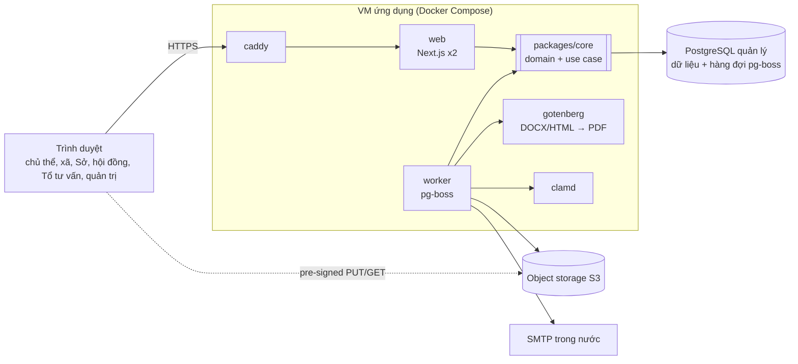

# OCOP – Phác thảo kiến trúc & lựa chọn công nghệ

19/10/2026 · Công ty TNHH MTV Điểm Chín

## 1. Kết luận và phạm vi

**Đề xuất:** một *modular monolith* viết bằng TypeScript (Next.js cho giao diện, một tầng domain thuần TS, một worker nền), chạy Docker Compose trên 1 VM ở cloud trong nước, dùng PostgreSQL làm nguồn sự thật duy nhất (kể cả hàng đợi job) và object storage S3-compatible cho tệp. Không microservice, không Kubernetes, không Redis ở bản rút gọn.

Lý do chính: bài toán là **workflow nghiệp vụ có trạng thái, phân quyền theo phạm vi và yêu cầu bất biến/kiểm toán cao**, nhưng quy mô nhỏ (một tỉnh, vài trăm đến vài nghìn hồ sơ mỗi năm). Độ phức tạp nằm ở tính đúng đắn của quy tắc, không nằm ở tải. Vì vậy ưu tiên: ít thành phần vận hành, transaction ACID xuyên suốt, domain kiểm thử được.

**Phạm vi đầu vào** (theo bảng tính năng rút gọn): 65 tính năng cho 9 nhóm đối tượng, 61 ở Đợt 1 (luồng lõi), 4 ở Đợt 2 (CT-15, SO-06, HD-12, CK-02: QR và thống kê). 41 mã gốc bị hoãn, làm ngoài hệ thống hoặc ngoài phạm vi; Bộ NN&MT không phải người dùng hệ thống.

Những tính năng quyết định kiến trúc:

- **Vòng đời hồ sơ 15 trạng thái** (L01 đến L17) với hai chế độ chấm: trực tiếp và dựa trên Tổ tư vấn (HD-06).
- **Bộ tiêu chí có phiên bản, cấu hình được, riêng theo nhóm sản phẩm** (AD-03, AD-04, AD-05); phiếu chấm phải gắn snapshot phiên bản.
- **Sao chép dữ liệu Tổ tư vấn sang phiếu thành viên** có nhãn nguồn, lưu giá trị gốc, không ghi đè phiếu đã chỉnh (TM-08, TM-09, TV-03, TV-04, AD-09).
- **Khóa bất biến**: báo cáo Tổ tư vấn đã phát hành, phiếu đã xác nhận, điểm đã chốt (TM-07, TV-05, HD-08).
- **Sinh văn bản** từ mẫu Word, giấy chứng nhận PDF, gói hồ sơ 5 sao ZIP, Excel (HD-09, HD-11, SO-04, DC-05).
- **Bảo mật**: RBAC theo phạm vi, TOTP cho hội đồng và quản trị, xác thực lại khi thao tác nhạy cảm, audit chỉ thêm, NĐ 13/2023 (AD-01, DC-09, AD-08, DC-10).

## 2. Yêu cầu phi chức năng và giả định

Tải thấp, nhưng yêu cầu về tính toàn vẹn và truy vết cao. Các con số dưới đây là giả định để chọn cỡ hạ tầng, cần xác nhận với Sở.

| Khía cạnh | Giả định / mục tiêu | Hệ quả kiến trúc |
| --- | --- | --- |
| Quy mô | 1 tỉnh; vài chục đến khoảng 150 xã/phường; vài trăm đến 1.000 hồ sơ/năm; dưới 3.000 tài khoản; vài chục người dùng đồng thời, đỉnh vào sát hạn nộp | 1 VM 4 vCPU / 8 GB đủ; không cần cache phân tán |
| Tệp | Minh chứng 50 đến 300 MB/hồ sơ (ảnh, PDF, video ngắn); tổng vài trăm GB/năm | Upload thẳng lên S3 bằng pre-signed URL, multipart; app không proxy byte |
| Tính đúng | Điểm đã khóa không được thay đổi; mọi chuyển trạng thái có sự kiện; số hiệu giấy chứng nhận không trùng | Ràng buộc ở cả domain lẫn DB (trigger, unique, row lock) |
| Truy vết | Audit chỉ thêm, giữ nhiều năm (cần xác nhận) | Bảng audit append-only, quyền DB tách riêng, có thể thêm hash chain |
| Sẵn sàng | Giờ hành chính là chính; chấp nhận bảo trì có báo trước. RPO ≤ 15 phút, RTO ≤ 4 giờ (đề xuất) | 1 VM + DB quản lý có failover hoặc PITR qua WAL; chưa cần active-active |
| Bảo mật | Cấp độ an toàn thông tin (dự kiến cấp 2 hoặc 3, cần xác nhận); NĐ 13/2023; dữ liệu đặt trong nước | Không dùng SaaS nước ngoài cho dữ liệu hoặc log (không Sentry cloud, không SendGrid) |
| Thiết bị | Chủ thể và cán bộ xã dùng điện thoại nhiều; Tổ tư vấn dùng màn hình lớn | Web responsive (DC-07), không app native; split view cho màn hình thẩm định |
| Ngôn ngữ, thời gian | Chỉ tiếng Việt; múi giờ Asia/Ho\_Chi\_Minh | Lưu `timestamptz` UTC, hiển thị giờ VN; tìm kiếm không dấu |
| Khả năng mở rộng nghiệp vụ | VNeID/SSO, Zalo, API mở, tra cứu công khai đã hoãn nhưng sẽ quay lại | Cổng trừu tượng (port/adapter) cho auth, notifier, file store; domain không phụ thuộc Next.js |

## 3. Kiến trúc tổng thể

Một codebase, ba tiến trình khi chạy: **web** (Next.js, phục vụ UI và route handler), **worker** (Node, xử lý job nền) và **gotenberg** (chuyển DOCX/HTML sang PDF). Cả web và worker gọi cùng một tầng domain; chỉ domain được ghi DB.

_Sơ đồ vẽ lại từ bản gốc: 1 VM ứng dụng, 3 dịch vụ quản lý (PostgreSQL, S3, SMTP)._

Mọi yêu cầu đi qua Caddy vào `web`; việc nặng chạy ở `worker`. Cả hai dùng chung `core`, nên quy tắc nghiệp vụ chỉ nằm ở một chỗ. Tệp đi thẳng từ trình duyệt lên S3 bằng pre-signed URL, không qua VM.

### 3.1 Phân lớp bên trong

1. **Giao diện** (`apps/web`): React Server Components để đọc, Server Actions hoặc route handler để ghi. Chỉ làm: xác thực phiên, parse input bằng Zod, gọi use case, map lỗi. Không chứa quy tắc nghiệp vụ.
2. **Application / use case** (`packages/core`): mỗi thao tác là một hàm `(actor, input) => result`, mở transaction, kiểm tra policy, gọi domain, ghi sự kiện, audit và outbox trong **cùng transaction**.
3. **Domain** (`packages/core/domain`): state machine hồ sơ, tính điểm, quy tắc sao chép, policy phân quyền. TS thuần, không import framework, test bằng unit test.
4. **Hạ tầng** (`packages/infra`): repository (Drizzle), adapter `FileStore` (S3), `Notifier` (SMTP, in-app), `DocRenderer` (docxtemplater + Gotenberg), `JobQueue` (pg-boss), `Clock`, `IdGen`.

Quy tắc phụ thuộc chỉ đi vào trong; lint bằng `eslint-plugin-boundaries` hoặc dependency-cruiser để không ai import Drizzle từ UI. Nếu sau này cần API mở (CK-04, DC-11) hay app di động, chỉ thêm một lớp REST mỏng gọi lại các use case này.

### 3.2 Module nghiệp vụ (bounded context)

Mỗi module sở hữu bảng của mình (cùng một DB, khác schema Postgres), chỉ gọi nhau qua hàm public hoặc domain event.

| Module | Trách nhiệm | Tính năng | Bảng chính |
| --- | --- | --- | --- |
| `identity` | Tài khoản, phiên, TOTP, xác thực lại, vai trò và phạm vi | CT-01, AD-01, AD-02, DC-09 | user, session, role\_assignment(role, scope\_type, scope\_id) |
| `org` | Chủ thể, hồ sơ pháp lý, danh mục xã, nhóm sản phẩm | CT-02, AD-06 | entity, legal\_doc, ward, product\_group |
| `criteria` | Bộ tiêu chí có phiên bản, ngưỡng hạng, quy tắc tổng hợp | AD-03, AD-04, AD-05 | criteria\_version, criterion, rank\_threshold |
| `round` | Đợt đánh giá, hạn nộp, chế độ chấm, nhắc hạn | SO-01, HD-06, CT-12 | round, round\_config |
| `dossier` | Hồ sơ sản phẩm, minh chứng, tự chấm, nộp, bổ sung, tiếp nhận xã, chuyển tỉnh; state machine | CT-03..11, XA-01..08, SO-02 | dossier, dossier\_event, evidence, ward\_checklist, supplement\_request |
| `council` | Hội đồng, Tổ tư vấn, phân công | HD-01..03 | council, council\_member, advisory\_team, assignment |
| `scoring` | Báo cáo Tổ tư vấn có phiên bản, sao chép, phiếu chấm, xác nhận, tổng hợp, chốt | TM-*, TV-*, HD-04, HD-05, HD-08 | advisory\_report(+version), score\_sheet, score\_entry, copy\_log, aggregate\_result |
| `outcome` | Biên bản, quyết định, giấy chứng nhận, kết quả không đạt, gói 5 sao, QR | HD-09..12, CT-13, CT-15, SO-04, CK-02 | meeting\_doc, certificate, cert\_counter, five\_star\_package |
| `reporting` | Thống kê, xuất Excel/PDF | SO-06, DC-05 | view / materialized view |
| Nền tảng dùng chung | Tệp, thông báo, audit, tìm kiếm, outbox | DC-01, DC-03, DC-04, AD-08, AD-09 | file\_object, notification, audit\_log, outbox |

## 4. Lựa chọn công nghệ

Một ngôn ngữ (TypeScript) từ UI đến worker, khớp với hướng Next.js + Docker Compose + S3 đã ghi trong phụ lục triển khai. Tiêu chí chọn: trưởng thành, tự host được trong nước, ít thành phần phải vận hành, dễ tuyển người.

| Tầng | Chọn | Vì sao | Phương án thay thế |
| --- | --- | --- | --- |
| Monorepo | pnpm workspaces + Turborepo | Tách `web`, `worker`, `core`, `infra`, `ui` mà vẫn một repo, một pipeline | Nx |
| Web / UI | Next.js (App Router), React, TypeScript strict | SSR cho máy yếu ở xã, một deploy cho cả UI và BFF, đã có trong phương án triển khai | React SPA (Vite) + API riêng |
| Thành phần UI | Tailwind CSS + shadcn/ui (Radix), TanStack Table, React Hook Form + Zod | Code thuộc về mình, dễ chỉnh theo bộ nhận diện; bảng dữ liệu và form chấm điểm là hai thành phần nặng nhất | Ant Design (nhanh hơn cho admin, khó tùy biến mobile) |
| API nội bộ | Server Actions + route handler, input/output schema bằng Zod dùng chung | Chỉ có một client (web), không cần hợp đồng REST công khai ở đợt này | NestJS + OpenAPI nếu đội muốn tách backend rõ ràng ngay từ đầu |
| ORM / truy vấn | Drizzle ORM (+ SQL thô khi cần), migration bằng drizzle-kit, kiểm soát bằng file SQL review được | Gần SQL, hỗ trợ tốt `SELECT ... FOR UPDATE`, JSONB, nhiều schema; không có engine nhị phân | Prisma (DX tốt, nhưng row lock và trigger phải viết SQL thô nhiều), Kysely |
| CSDL | PostgreSQL 16/17 + `unaccent`, `pg_trgm`, `citext` | ACID, JSONB cho snapshot, FTS tiếng Việt không dấu, trigger bảo vệ bất biến; GreenNode có bản quản lý | Không có lý do dùng DB khác |
| Hàng đợi job, cron | pg-boss (trên Postgres) | Job được enqueue trong cùng transaction nghiệp vụ; không thêm Redis | BullMQ + Redis khi cần thông lượng lớn |
| Xác thực | Tự viết trong `identity` (ADR 0005): argon2id qua `@node-rs/argon2`, TOTP qua `otplib`, phiên DB lưu hash token | Khóa tạm theo tài khoản, hết phiên theo Vai trò, audit cùng transaction; Better Auth không đáp ứng được mà không vá nhiều | Better Auth (đã cân nhắc, xem ADR 0005); Keycloak khi làm VNeID/SSO |
| Phân quyền | Policy tự viết trong domain: `can(actor, action, resource)` dựa trên vai trò + phạm vi + trạng thái | Quy tắc phụ thuộc trạng thái (ẩn điểm trước khi chốt, Tổ tư vấn không chốt được) khó diễn tả bằng thư viện; test dạng bảng | CASL; Postgres RLS làm lớp phòng thủ thứ hai (sau) |
| Tệp | S3-compatible qua `@aws-sdk/client-s3` v3, pre-signed PUT/GET, multipart | Theo phụ lục A: GreenNode vStorage, FPT, Viettel đều công bố S3 API | MinIO tự host nếu nhà cung cấp không đạt kiểm thử |
| Quét mã độc | ClamAV (container `clamd`) quét sau upload | Tệp từ chủ thể là nguồn không tin cậy, lại được cán bộ mở | Dịch vụ quét của nhà cung cấp cloud nếu có |
| Văn bản Word | docxtemplater (biên bản, quyết định, thư kết quả) | Nghiệp vụ tự sửa mẫu .docx, không cần dev | carbone.io |
| PDF | Gotenberg (LibreOffice + Chromium trong container): DOCX → PDF, HTML → PDF cho giấy chứng nhận; cài sẵn font tiếng Việt (Times New Roman có bản quyền hoặc font mở như Noto Serif) | Một đường render cho mọi loại, cô lập khỏi tiến trình web | Playwright/Puppeteer tự quản |
| Excel, ZIP, QR | ExcelJS (streaming), archiver (stream thẳng lên S3), `qrcode` | Đủ cho SO-06, DC-05, SO-04, HD-12 | SheetJS |
| Email | Nodemailer qua SMTP cơ quan hoặc nhà cung cấp trong nước; SPF, DKIM, DMARC; mẫu bằng React Email | Dữ liệu không ra ngoài lãnh thổ | Adapter SMS/Zalo sau (DC-02) |
| Thông báo trong ứng dụng | Bảng `notification` + polling 30 đến 60 giây (hoặc SSE) | Không cần WebSocket cho mức tương tác này | SSE qua route handler |
| Reverse proxy | Caddy (TLS tự động, header bảo mật, giới hạn kích thước body) | Cấu hình ngắn; đã có trong phương án | Nginx (nếu đơn vị vận hành quen) |
| Kiểm thử | Vitest (domain), Testcontainers + Postgres thật (use case, trigger), Playwright (E2E theo vai trò) | Quy tắc nằm nhiều ở DB nên phải test với Postgres thật | Jest |
| Quan sát | pino (log JSON) → Grafana Loki; Prometheus + node/postgres exporter; GlitchTip tự host cho lỗi; Uptime Kuma | Tất cả tự host trong nước; hoặc dùng vMonitor của GreenNode | OpenTelemetry khi có nhiều dịch vụ |
| CI/CD | GitLab CI hoặc GitHub Actions: lint, typecheck, test, build image, quét image (Trivy), deploy bằng `docker compose pull && up` qua SSH | Đơn giản, đủ cho 1 VM; image lưu ở registry của nhà cung cấp | Kamal |

## 5. Thiết kế các điểm khó

Phần lớn hệ thống là CRUD có phân quyền. Sáu chỗ dưới đây cần thiết kế kỹ từ ngày đầu vì sửa sau rất đắt.

### 5.1 State machine hồ sơ

- Khai báo bảng chuyển trạng thái dạng dữ liệu: `{from, to, action, guard, roles}`, lấy đúng 15 trạng thái ở mục 1.2 của tài liệu luồng xử lý. Không cần XState; một map có kiểu là đủ và test được toàn bộ bằng bảng.
- Mọi chuyển trạng thái đi qua một hàm `transition()` duy nhất: cập nhật `dossier.status` với optimistic lock (`version`), ghi `dossier_event` (ai, khi nào, từ, sang, lý do), ghi `outbox` cho thông báo. Tất cả trong một transaction.
- Chế độ chấm là thuộc tính của đợt và bị khóa khi có phiếu đầu tiên (L09). Guard của nhánh "Đã chuyển tỉnh → Tổ tư vấn thẩm định / Thành viên xem xét" đọc giá trị này.
- Ngưỡng 3/4/5 sao không viết cứng: đọc từ `rank_threshold` của phiên bản tiêu chí mà đợt đang dùng.

### 5.2 Bộ tiêu chí có phiên bản

- `criteria_version` (draft → published, bất biến sau khi publish) → `criteria_section` (A/B/C) → `criterion` (mã, điểm tối đa, mô tả, minh chứng yêu cầu, kiểu nhập: thang rời rạc hay số). Mỗi nhóm sản phẩm trỏ tới một phiên bản riêng (AD-05).
- Chuẩn hóa thành bảng (không nhét cả cây vào JSONB) để `score_entry.criterion_id` có FK thật. Vì criterion của phiên bản đã publish không bao giờ đổi, FK chính là snapshot.
- Trigger Postgres chặn UPDATE/DELETE trên mọi dòng thuộc phiên bản đã publish.
- Quy tắc tổng hợp điểm (trung bình, loại điểm lệch, ngưỡng cờ chênh lệch) là một enum + tham số trong `round_config`, không phải biểu thức tự do.

### 5.3 Phiếu chấm, sao chép từ Tổ tư vấn và khóa bất biến

- `advisory_report_version` bất biến sau khi phát hành (TM-07); sửa = tạo N+1 có lý do.
- `score_entry` mỗi dòng một tiêu chí, gồm: `value`, `comment`, `basis`, `source` (`advisory` | `member`), `advisory_version_id`, `advisory_value_original`, `adjust_reason`. `score_sheet` có `state` (`empty`, `prefilled`, `edited`, `confirmed`, `locked`).
- Quy tắc sao chép lại (L12) là một hàm thuần: phiếu `prefilled` thì cập nhật, `edited` / `confirmed` / `locked` thì bỏ qua và trả về danh sách bị bỏ qua. Thao tác hàng loạt (TM-09) chạy trong một transaction, ghi một `copy_batch` + nhiều `copy_log`.
- TV-04: domain từ chối xác nhận khi `value ≠ advisory_value_original` mà `adjust_reason` rỗng.
- Khóa ba lớp: domain từ chối, trigger DB chặn UPDATE khi `state in ('confirmed','locked')`, và user DB của ứng dụng không có quyền tắt trigger. Mở khóa (AD-10, đã hoãn) là một stored procedure riêng chạy bằng tài khoản quản trị kỹ thuật, tự ghi audit.
- Khi chốt (HD-08), lưu `aggregate_result` gồm điểm tổng hợp, hạng gợi ý và bản JSONB snapshot toàn bộ phiếu, kèm hash SHA-256 để đối chiếu sau này.

### 5.4 Phân quyền theo vai trò, phạm vi và trạng thái

- `role_assignment(user_id, role, scope_type, scope_id, valid_from, valid_to)` với scope là chủ thể, xã, tỉnh, hội đồng hoặc hệ thống. Phân công theo từng hồ sơ là bảng `assignment` của module `council`, policy đọc cả hai. Một người nhiều vai trò; UI có bộ chuyển vai trò nhưng server luôn kiểm tra theo vai trò đang chọn.
- Policy là hàm thuần trong domain, dùng cho cả kiểm tra thao tác lẫn lọc truy vấn (repository nhận `actor` và tự thêm điều kiện phạm vi). Không có đường đọc dữ liệu nào bỏ qua `actor`.
- Các quy tắc phải có test ma trận (TM-12 ghi rõ "chính sách phân quyền có test"): Tổ tư vấn không chốt điểm và không quyết định công nhận; thành viên chỉ thấy hồ sơ được phân công; ẩn điểm người khác đến khi chốt; một người không vừa là Tổ tư vấn vừa chấm cùng hồ sơ; chủ thể không thấy điểm từng thành viên.
- Xác thực lại (step-up) cho xác nhận phiếu và chốt điểm: yêu cầu mã TOTP mới trong vòng 5 phút, ghi `auth_at` vào audit của thao tác.

### 5.5 Tệp, audit và tìm kiếm

- **Tệp:** client xin pre-signed URL → upload thẳng lên bucket `quarantine/` → worker quét ClamAV, tính SHA-256, sinh thumbnail/PDF xem trước → chuyển sang `evidence/`. `file_object` lưu key, kích thước, MIME thật (đọc magic bytes), hash, người tải, liên kết tới tiêu chí. Tải xuống luôn qua pre-signed GET ngắn hạn sau khi kiểm tra policy. Lưu ý GreenNode: CopyObject trả 501 khi bật SSE, nên bước "chuyển" nên là cập nhật trạng thái trong DB thay vì copy object.
- **Audit:** bảng `audit_log` partition theo tháng, user ứng dụng chỉ có quyền INSERT. Mỗi dòng có `prev_hash` để phát hiện sửa xóa (tuỳ chọn, rẻ). Truy cập dữ liệu cá nhân (xem hồ sơ pháp lý) cũng ghi, đáp ứng NĐ 13/2023.
- **Tìm kiếm (DC-04):** cột `search_text` sinh từ tên sản phẩm, chủ thể, mã hồ sơ, xã, đã qua `unaccent` + `lower`, index GIN `pg_trgm`. Đủ cho vài nghìn hồ sơ; không cần Elasticsearch/OpenSearch.

### 5.6 Sinh văn bản, số hiệu và QR

- Mẫu .docx lưu trong DB/S3 có phiên bản (S73), render bằng docxtemplater trong worker, chuyển PDF qua Gotenberg. File kết quả là bản nháp; bản ký số ngoài hệ thống được tải lên thay thế và đánh dấu `signed`.
- Số hiệu giấy chứng nhận: bảng `cert_counter(year, prefix, next_value)` lấy bằng `UPDATE ... RETURNING` trong transaction cấp giấy, kèm unique `(year, number)`. Không dùng sequence vì sequence có lỗ hổng khi rollback.
- QR (Đợt 2): URL `https://<domain>/xac-thuc/<số hiệu>.<HMAC rút gọn>`; khóa HMAC nằm trong secret, có hỗ trợ xoay khóa. Trang xác thực là route công khai duy nhất, rate limit theo IP ở Caddy, cache ngắn, chỉ trả trường được phép công bố.
- Gói 5 sao (SO-04) là job nền: stream các object từ S3 qua archiver thẳng ngược lên S3 (multipart), không giữ cả gói trong RAM; xong thì thông báo kèm link tải ngắn hạn.

## 6. Hạ tầng, triển khai và vận hành

Giữ đúng hướng ở phụ lục A: 1 VM ứng dụng chạy Docker Compose, PostgreSQL quản lý (ưu tiên GreenNode vDB vì đã có cluster + failover), object storage S3 trong cùng vùng, tất cả trong VPC.

### 6.1 Các container trên VM ứng dụng

| Container | Vai trò | Ghi chú tài nguyên |
| --- | --- | --- |
| `caddy` | TLS, HSTS, CSP, rate limit, giới hạn body, chỉ mở 80/443 | Nhẹ |
| `web` | Next.js standalone output, 2 replica sau Caddy để deploy không gián đoạn | \~512 MB mỗi replica |
| `worker` | pg-boss: email, nhắc hạn, render văn bản, đóng gói ZIP, quét tệp, xuất Excel | Giới hạn đồng thời theo loại job |
| `gotenberg` | DOCX/HTML → PDF | 1 đến 2 GB khi render; chỉ nghe trong mạng nội bộ Docker |
| `clamd` | Quét mã độc | \~1,5 GB RAM cho cơ sở dữ liệu chữ ký |
| `migrate` (chạy một lần) | Chạy migration trước khi `web` lên | Dùng user DB có quyền DDL, tách khỏi user ứng dụng |

Cộng lại khoảng 5 đến 6 GB khi cao điểm, nên chọn **4 vCPU / 8 GB** như bảng đề xuất, nâng lên 16 GB nếu ClamAV và Gotenberg cùng chạy nặng. Giám sát (Loki, Prometheus, Grafana, GlitchTip, Uptime Kuma) đặt trên một VM nhỏ riêng để còn thấy được khi VM ứng dụng sập.

### 6.2 Môi trường và quy trình phát hành

1. Ba môi trường: `dev` (local, Postgres + S3 RustFS trong Compose; MinIO đã ngừng phát hành image cộng đồng), `staging` (VM nhỏ, dữ liệu giả), `prod`. Staging dùng cùng nhà cung cấp S3 với prod để bắt lỗi tương thích sớm.
2. Pipeline: lint, typecheck, unit test, integration test (Testcontainers), build image có tag theo commit, quét Trivy, đẩy lên registry, deploy staging tự động, E2E Playwright trên staging, deploy prod bằng thao tác duyệt tay.
3. Migration kiểu expand/contract để rollback ứng dụng mà không rollback schema.
4. Secret (khóa DB, S3, SMTP, HMAC QR, khóa mã hóa TOTP) nằm trong file env chỉ root đọc được hoặc secret manager của nhà cung cấp nếu có; không commit.

### 6.3 Sao lưu và khôi phục

- DB: snapshot hằng đêm + WAL liên tục (dịch vụ quản lý, hoặc pgBackRest nếu tự chạy) để có PITR, đáp ứng RPO 15 phút.
- Bucket: versioning bật cho `evidence/` và `certificates/`; Object Lock nếu nhà cung cấp hỗ trợ; sao chép sang vùng hoặc nhà cung cấp thứ hai bằng `rclone` theo lịch.
- Lifecycle: bucket evidence có quy tắc xóa tiền tố `exports/` sau 7 ngày (Gói đề nghị 5 sao, #89) và hủy multipart dở dang sau 1 ngày; worker tự đặt khi `S3_AUTO_CREATE_BUCKETS=true`, môi trường khác do vận hành đặt.
- Diễn tập khôi phục mỗi quý trên staging, ghi lại thời gian thực tế so với RTO.

### 6.4 Bảo mật và tuân thủ

- Mật khẩu argon2id; khóa tạm sau N lần sai; TOTP bắt buộc cho hội đồng, Tổ tư vấn, quản trị; secret TOTP mã hóa ở tầng ứng dụng.
- Cookie phiên `HttpOnly`, `Secure`, `SameSite=Lax`; Server Actions đã có kiểm tra Origin, bổ sung CSP nghiêm và chặn nhúng iframe.
- Ba user DB: `migrator` (DDL), `app` (DML, chỉ INSERT trên audit), `readonly` (báo cáo, hỗ trợ). DB và S3 chỉ truy cập qua private endpoint.
- NĐ 13/2023: danh mục dữ liệu cá nhân (CCCD, số điện thoại, địa chỉ trong hồ sơ pháp lý), điều khoản đồng ý khi đăng ký, ghi log truy cập, chính sách thời hạn lưu trữ. Hồ sơ đề xuất cấp độ an toàn thông tin cần làm sớm vì ảnh hưởng lựa chọn nhà cung cấp.
- Kiểm thử xâm nhập độc lập trước khi mở cổng cho chủ thể và trước khi mở trang xác thực QR công khai.

## 7. Lộ trình, rủi ro và câu hỏi mở

### 7.1 Thứ tự xây dựng

Làm nền và các điểm khó trước, rồi đi theo chiều của hồ sơ để luôn có một luồng chạy được từ đầu đến cuối.

1. **Nền tảng:** monorepo, CI, Compose, `identity` (đăng nhập, TOTP, vai trò + phạm vi), audit, outbox + pg-boss, `FileStore` S3, khung UI theo vai trò. Viết bộ kiểm thử tương thích S3 (endpoint qua biến môi trường; CI chạy với MinIO), chạy với GreenNode, FPT, Viettel khi có tài khoản dùng thử; không chặn hoàn thành bước 1.
2. **Tiêu chí và đợt:** `criteria` có phiên bản + trình soạn (AD-03..05), `round` (SO-01, AD-06). Đây là điều kiện của mọi phiếu chấm.
3. **Chủ thể và xã:** L01 đến L06 (hồ sơ, minh chứng, tự chấm, nộp, bổ sung, tiếp nhận, sinh biên bản xã). Có thể cho thí điểm sớm để thu hồ sơ thật.
4. **Cấp tỉnh và chấm điểm:** L07 đến L15 (tiếp nhận tỉnh, hội đồng, Tổ tư vấn, sao chép, phiếu, xác nhận step-up, tổng hợp, chốt). Phần rủi ro nhất, nên có test ma trận phân quyền và test trigger khóa trước khi làm UI.
5. **Kết quả:** L16, L17 (giấy chứng nhận PDF, thư kết quả, gói 5 sao), xuất Excel/PDF (DC-05).
6. **Đợt 2:** QR trên giấy chứng nhận, trang xác thực công khai (sau pentest và WAF), thống kê SO-06.

### 7.2 Rủi ro kỹ thuật

| Rủi ro | Ảnh hưởng | Giảm thiểu |
| --- | --- | --- |
| S3 của nhà cung cấp trong nước lệch chuẩn AWS (checksum SDK v3, path-style, CopyObject + SSE) | Upload/tải lỗi ở prod | Chạy bộ test tương thích ngay bước 1; cấu hình `requestChecksumCalculation: WHEN_REQUIRED`; không phụ thuộc CopyObject |
| Quy chế thay đổi (ngưỡng, phân bổ A/B/C, bắt buộc báo cáo Tổ tư vấn) | Sửa code giữa đợt | Mọi tham số nằm trong `criteria_version` / `round_config`; guard của state machine đọc cấu hình |
| Server Actions bị dùng như API công khai mà quên kiểm tra quyền | Lộ hoặc sửa dữ liệu | Kiểm tra quyền nằm trong use case, không trong component; lint cấm gọi repository từ `apps/web` |
| Thành viên chấp nhận điểm Tổ tư vấn mà không xem | Sai lệch nghiệp vụ | Xác nhận từng phiếu bằng step-up, lưu điểm gốc; dữ liệu sẵn cho báo cáo đối chiếu HD-07 sau này |
| Render PDF/ZIP lớn chiếm hết RAM VM | Web chậm lúc cao điểm | Chạy trong worker với giới hạn đồng thời, stream thay vì buffer, `mem_limit` cho Gotenberg |
| Chưa có PostgreSQL quản lý ở FPT/Viettel | Tự vận hành DB | Chọn GreenNode, hoặc tự chạy Postgres trên VM riêng + pgBackRest + diễn tập khôi phục |

### 7.3 Câu hỏi cần chốt trước khi code phần liên quan

- Đội phát triển muốn backend tách riêng (NestJS + OpenAPI) hay chấp nhận Next.js full-stack với tầng domain độc lập? Tài liệu này mặc định phương án thứ hai.
- Cấp độ an toàn thông tin của hệ thống và yêu cầu đối với nhà cung cấp cloud.
- Quy chế hội đồng: số thành viên chấm, quy tắc tổng hợp điểm, thành viên có thấy điểm nhau trước khi chốt không (ảnh hưởng policy và truy vấn).
- Thời hạn lưu audit, hồ sơ và minh chứng (ảnh hưởng partition và chi phí lưu trữ).
- SMTP dùng của cơ quan hay dịch vụ riêng; tên miền chính thức (ảnh hưởng QR in trên giấy chứng nhận, không đổi được sau khi in).

Tài liệu tham chiếu trong dự án: bảng tính năng rút gọn (OCOP\_tinh\_nang\_rut\_gon.xlsx), luồng xử lý (OCOP\_luong\_xu\_ly\_ban\_rut\_gon.md), mô tả màn hình (OCOP\_mo\_ta\_man\_hinh\_ban\_rut\_gon.md).
